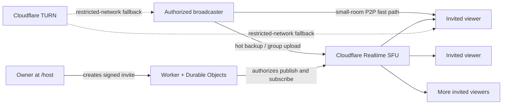

# Jiahao Private Cinema v2.3.7

## v2.3.7：按需备用与可验证诊断

- 观看端默认 `Backup → On demand`：P2P 已切为可见画面并稳定保留8秒后关闭后台 SFU 接收。可选 `Hot` 保持原有热备行为。
- 所有观众都上报本次广播正在通过 P2P 播放、不需要 SFU，且上报未过期时，Host 才暂停 SFU 编码发送。仅仅连接成功不会触发暂停。
- 备用恢复先发送唤醒请求，Host 恢复发送后确认，再准备 SFU；切换仍先等替代画面，后退役旧连接。按需模式有恢复等待，不承诺无缝、零黑屏或零丢包。
- 观看端 `Route → SFU only` 可隔离测试 SFU，不会继续后台 P2P 探测；`Auto` 恢复 P2P 优先。
- 新增实际采集统计（浏览器提供时）、每帧编解码耗时、抖动缓冲、新增冻结、活动连接负载。缺失数据显示 Unknown，不把设置30fps当作实际30fps。
- 评级连续两个采样才改变；原始数值和恢复判断不做这种平滑。
- `Export diagnostics / 导出诊断` 导出本页最近最多240次采样及200条路由事件；不上传，不含电影、聊天、姓名、邀请密钥、SDP或ICE地址。浏览器版本和媒体指标仍属于设备诊断信息，请审阅后再分享。
- 修复 ICE 请求等待期间重复创建连接、未出画候选未退出、SFU 预热播放器未清理；每路发送用独立轨道克隆并在退役时释放。克隆仍共享底层采集源，不宣称完全隔离浏览器自适应。

更新时必须同时部署 `public/` 和 `src/`；双方刷新并确认左上角 `v2.3.7`。无需新建房间、修改密钥或数据库迁移。此更新不修复 Windows / 显卡驱动层卡死。

An invitation-only watch-together cinema designed for long-term deployment on Cloudflare.

The owner creates a private screening at `/host`, sends signed invitations, and shares a browser tab or screen. Small rooms prefer direct WebRTC, with an on-demand SFU backup by default or an optional continuously receiving hot backup. Movie files are not uploaded to the Worker or Durable Objects.

## What changed in v2

- Real server-side owner, host, and viewer permissions
- Cryptographically signed, expiring and revocable invitations
- One-time WebSocket tickets so invitation tokens do not stay in socket URLs
- Hybrid media: direct P2P for up to three viewers plus a live Cloudflare SFU backup/fan-out path
- No application-level viewer cap
- Simulcast quality layers: Data saver, Balanced, High, and Auto
- TURN credentials only for authenticated people who are already inside a room
- Room locking, removal, guest-host invitations, and invitation revocation
- Cross-country stream diagnostics: route, transport, bitrate, RTT, packet loss, jitter, resolution, and FPS
- Server-side duplicate-connection protection and automatic reconnect
- Chats are transient and are not persisted
- Login and media endpoint rate limits plus strict browser security headers

## Architecture



## Deploy

Read [DEPLOY.md](DEPLOY.md). It covers the six required secrets, the safe upgrade path from v1, and the first real two-network test.

After deployment:

1. Open `https://your-domain.example/host`.
2. Sign in with the owner password.
3. Create a room and copy a viewer invitation.
4. Open the invitation on a different device/network.
5. Start broadcasting and choose a Chrome or Edge tab with **Share tab audio** enabled.

For a local file, MP4/H.264/AAC is the most browser-friendly combination. The file stays on the broadcaster's computer. Streaming services with DRM may intentionally show a black screen; this project does not bypass DRM.

## Development

```text
npm install
npm run check
npm run dev
```

No permanent credential belongs in the repository. Put every secret in Cloudflare **Variables and Secrets** as a Secret.

## Operational notes

- The root page has no public room list. Without a valid invitation it is a closed door.
- Room and invitation lifetime is limited to seven days; create a new room for a later screening.
- Locking a room blocks new devices while preserving reconnect access for viewers already admitted with that invitation.
- A guest-host link grants real broadcasting permission. Treat it as sensitive and revoke it after use.
- “Cloudflare TURN fallback is ready” means TURN credentials are available, not that the current stream is consuming TURN bandwidth.
- The Network panel reports the actual selected WebRTC path and live transport statistics.

See [SECURITY.md](SECURITY.md) for the trust model and [TESTING.md](TESTING.md) for the pre-release checklist.

## v2.3.6 Adaptive P2P return probes

- Falling back to SFU no longer locks a Viewer there for a fixed ten minutes.
  The Viewer retries P2P after 60 seconds, then three minutes, then ten minutes
  after repeated failed probes. If the control WebSocket is temporarily down,
  the Viewer waits and asks again after it reconnects instead of losing the
  retry forever.
- Every retry is make-before-break: the SFU video remains visible and audible
  while a hidden P2P candidate connects and is measured for six seconds.
- The candidate must decode fresh frames, maintain at least 18 fps, retain a
  useful resolution relative to the SFU picture, and either stay at or below
  3% packet loss or materially outperform a bad SFU path. Only then can it
  replace SFU.
- A failed P2P probe is discarded without touching the visible SFU connection.
  A successful probe resets the retry backoff.
- Sustained P2P loss no longer causes a blind switch. The Viewer measures P2P
  and SFU over the same interval and changes route only when SFU is demonstrably
  healthier. A paused/static movie is treated as an inconclusive sample, not a
  failed network path.
- P2P is not retired until SFU has decoded and displayed a frame. Probe results
  are generation-checked so an old candidate cannot override a new movie,
  connection, or room size; rooms above three Viewers cancel outstanding P2P
  probes and use SFU fan-out.
- Host diagnostics now distinguish the Host's always-on SFU backup upload from
  each Viewer's actual `P2P`, `P2P/TURN`, `SFU`, or `SFU/TURN` route.

This removes the misleading assumption that the Host's SFU publisher status is
the Viewer's active route and lets cross-border/VPN paths recover back to P2P
when their network conditions improve.

## v2.3.5 Control-loop and lossy-P2P recovery

- Browser tabs now keep independent participant identities. Reloads and network
  hand-offs still preserve one tab's identity, but a second tab can no longer
  start an endless cycle in which both sockets repeatedly replace each other.
- If a newer tab deliberately replaces an older one, the older page stops
  reconnecting and clearly says that another tab has taken control.
- Repeated control reconnections are condensed into one counter in room chat,
  rather than appending an unlimited list of `Connection restored` messages.
- A Viewer on direct P2P no longer has to wait for the picture to freeze before
  recovery begins. Two consecutive five-second samples at 8% packet loss or
  more trigger verification of the decoded hot SFU backup, followed by a
  make-before-break switch when that backup is healthy.
- The capture-source message is styled as a neutral operating tip unless live
  sender statistics actually detect browser background throttling.

The sender cannot erase packet loss on a remote VPN or Wi-Fi path. This release
instead stops treating a high-loss P2P connection as healthy and moves the
Viewer to a verified alternative path before the stream becomes unusable.

## v2.3.4 Frozen-video recovery

- Viewer playback is no longer considered healthy merely because WebRTC still
  says `connected`. A watchdog checks inbound decoded frames, actual frames
  presented by the visible video element, and audio progress every 2.5 seconds.
- If audio continues while video produces no new frame for 7.5 seconds, the
  route is treated as frozen. A complete media silence uses a conservative
  15-second threshold so a deliberately paused or static source does not flap.
- A frozen P2P route first verifies the hot SFU backup. If necessary it creates
  a fresh SFU subscription, waits for its first frame, and only then switches.
- A frozen SFU route is replaced make-before-break. The old picture remains on
  screen until the new subscription has decoded a frame, so recovery does not
  require the Viewer to refresh the page.
- If the visible video element was locally paused by browser controls or an
  autoplay interruption, the watchdog resumes it automatically.

This is the primary repair for a Viewer whose picture freezes while the room
and WebRTC connection still appear online. v2.3.3's reconnect grace remains as
a secondary protection when a Viewer refreshes or changes networks.

## v2.3.3 Control reconnect stabilization

- A temporary room WebSocket outage no longer emits an immediate leave event.
  The same logical participant remains present for a 45-second reconnect grace
  period while an existing P2P or SFU media route is preserved.
- A returning browser is announced as reconnected, not as a newly joined
  device. The Host therefore does not close and rebuild a healthy P2P route.
- The participant list shows `reconnecting` during the grace period. A real
  departure is announced only after the grace expires, or immediately when the
  user explicitly chooses Leave, is removed, or the screening ends.
- Repeated WebSocket welcomes no longer fill the room chat with duplicate
  `You entered as ...` messages.

This specifically fixes the failure mode where a VPN or cross-border control
connection briefly flapped and the application itself amplified it into a
visible movie pause. It does not claim that an underlying media-path outage can
never occur; v2.3.2's hot SFU/P2P fallback still handles that separate layer.

## v2.3.2 Seamless route switching

- Viewers keep separate P2P and SFU video pipelines. The hidden backup keeps
  playing muted instead of being destroyed when the direct route wins.
- A route is not displayed until its first video frame has decoded. Only then
  does the UI atomically mute the old route and reveal the new one.
- The Host keeps SFU sender tracks live in small rooms. This uses more bandwidth
  than cold standby, but removes the black gap while SFU publication resumes.
- A failed P2P path is pinned to SFU for ten minutes. The endpoints exchange a
  bounded `defer` signal instead of flapping between paths every few seconds.
- Transient ICE `disconnected` state gets a twelve-second grace period. SFU
  replacement subscriptions also retire the old connection only after the
  replacement has decoded a frame.
- Stream Health shows the route-switch reason and total switch count.

No new Cloudflare binding or secret is required. Because SFU is a true hot
backup, Realtime traffic can continue while a Viewer watches over P2P. This is
the intentional reliability tradeoff in v2.3.2.

## v2.3.1 Caption sizing and playback clock

- Captions default to a smaller cinema-safe size. Each endpoint can independently
  choose Smaller, Standard, or Larger without changing anyone else's view.
- Caption timing now uses a room clock controlled by the Host. Pausing or
  resuming that clock affects every endpoint while each viewer retains their own
  language and offset.
- **Open local video** launches the built-in controlled player. Supported local
  MP4/WebM playback, pause, and seeking update the room subtitle clock
  automatically.
- A third-party cross-origin tab such as Tencent Video cannot expose its private
  playback state to this site. For those sources, the Host uses the one-click
  **Pause subtitles / Resume subtitles** control.

## v2.3.0 Room Caption Library and capture-source guidance

- A Host can upload up to 12 `.srt` or `.vtt` tracks to the current room. The
  tracks are stored with that room in Durable Object storage and are removed
  when the room is permanently deleted.
- Every invited endpoint receives the same track list but independently chooses
  its language, offset, or **Off**. Selecting Russian on one device does not
  change English on another device.
- Only authorized Hosts can add or remove tracks. A valid room invitation is
  required to download a track; subtitle files are not exposed on a public URL.
- The Host UI now always explains Chrome's capture-source throttling workaround:
  move the movie tab into its own browser window and keep that window active.
  When the captured source reports 24/30 fps but WebRTC stays near 15 fps for
  several samples without network loss, the warning is highlighted and a toast
  is shown.

Room captions use the live screen-share clock plus each endpoint's manual
offset. A browser cannot read the private playback clock of a Tencent Video or
other cross-origin player, so pausing/seeking that external player may require
offset correction. Exact pause/seek synchronization requires a future Host
Companion or an integrated local player that owns the movie clock.

## v2.2.3 quality-first direct media and room cleanup

- Direct P2P now requests a single full-resolution encoding and uses
  `maintain-resolution`, so WebRTC bandwidth ramp-up should reduce motion or
  compression before shrinking a film to 270p.
- Stream diagnostics distinguish the captured source from the encoded output
  and show the browser's estimated available bandwidth.
- The owner dashboard can permanently delete any room. Deleting an active room
  disconnects its participants and invalidates its invitations.
- Ended/expired room history is pruned after seven days, and newly-created room
  Durable Object state is automatically purged after the same retention window.

## v2.2.2 direct-first media and endpoint subtitles

> Historical note: v2.3.2 supersedes the cold-SFU behavior below. SFU tracks are
> now kept live so fallback is frame-ready before the visible route changes.

- Up to three viewers use separate direct P2P fast paths. A fourth viewer
  switches the room to SFU fan-out so Host upload does not grow without bound.
- Once every small-room viewer has held a direct connection for three seconds,
  the Host pauses its parallel SFU sender tracks. This removes duplicate
  P2P-plus-simulcast encoding/upload that could make Chrome's congestion
  controller reduce a healthy direct stream to 480x270. The SFU PeerConnection
  remains allocated as a cold standby and resumes before a direct fallback or
  larger-room transition.
- Active SFU mode now publishes only two cinema-grade layers: 1080p with a
  720p fallback, or 720p with a 540p fallback. The previous 180p/270p emergency
  layer was removed because maintaining a connection below the product's
  watchable quality floor is not a useful movie experience.
- The control WebSocket now sends a heartbeat. Losing that control connection
  briefly no longer stops screen capture or immediately tears down healthy
  media; the server grants the broadcaster a 30-second reconnect window.
- Failed or disconnected P2P routes fall back to the SFU and retry direct ICE
  with bounded backoff. Returning online also triggers a direct-route retry.
- Every endpoint can load one or more local `.srt`/`.vtt` files, select its own
  language track, and adjust its own subtitle offset. v2.3.0 supersedes this
  local-only workflow with the authenticated Room Caption Library.

Endpoint subtitles are intentionally separate from the video. For a captured
Tencent/streaming tab the cinema cannot read the third-party player's pause or
seek position, so use the ±1 second offset controls and avoid seeking after
alignment. A later caption service can publish timestamped speech-to-text and
translations over the room control channel without changing the media route.

## v2.1.1 small-room routing and reconnection

- Up to three viewers can now receive separate direct WebRTC connections from
  the Host. Adding a second viewer no longer forces the whole room onto the
  Cloudflare SFU.
- A fourth viewer switches the room to SFU fan-out so Host upload and encoding
  do not continue growing without a bound.
- Each admitted browser now keeps a stable logical participant ID. Replacing a
  Wi-Fi connection with mobile data still requires ICE/WebSocket reconnection,
  but the replacement session is no longer presented as a brand-new device.
- The local-video picker now allows MKV files. Playback still depends on the
  codecs inside the container; when the browser cannot decode a file, remux it
  to browser-compatible MP4 or share a VLC/mpv window.
- P2P is not limited to a LAN. ICE tries direct internet candidates first and
  can use the authenticated TURN service when NAT or firewall rules prevent a
  direct path.

Small-room direct fan-out trades server routing for Host resources. At the
default 2.2 Mbps profile, three viewers may require roughly 6.6 Mbps plus
protocol overhead of sustained Host upload. Use the SFU for larger rooms.

## v2.1.0 hybrid media routing

- With exactly one viewer, the cinema now establishes a direct WebRTC P2P fast
  path while keeping the Cloudflare SFU stream available as a fallback.
- If direct ICE succeeds, the viewer automatically leaves the SFU download and
  the Network panel changes to **Direct P2P**.
- If P2P fails, the existing SFU playback continues without interrupting the
  screening. TURN candidates remain available for restrictive NATs and
  firewalls.
- When a second viewer enters, direct mode closes and every viewer uses the SFU
  so Host upload does not grow once per audience member.
- Selected-candidate detection now also uses WebRTC transport stats, which fixes
  `UNKNOWN` route/transport reporting in WebKit-based iPhone browsers.

This mirrors the practical two-person/group split used by mature watch-party
products: direct media for two devices, relayed media for groups. The website,
authentication, room state and signaling still run on Cloudflare in both modes.

## v2.0.3 mobile playback update

- Best quality and Balanced are adaptive preferences. They can step down when a
  phone or network cannot sustain the preferred simulcast layer.
- Default 720p publishing is capped at 2.2 Mbps; the optional 1080p profile is
  capped at 3.5 Mbps to avoid turning moderate loss into severe frame stalls.
- Data saver remains an explicit low-bandwidth choice.
- Packet loss and frame drops are reported per five-second interval instead of
  as misleading lifetime totals.
- Host diagnostics consistently show the largest active simulcast layer rather
  than whichever RTP report the browser returned last.
- TURN credential generation now sends the request body documented by
  Cloudflare (`ttl` only), fixing the observed HTTP 400 warning.

For mobile viewers, leave Quality on **Auto (recommended)**. Best quality means
"prefer the best available layer," not "ignore congestion and force 1080p."

## License

This is proprietary software. All rights reserved. See [COPYRIGHT.md](https://github.com/jujizh/jujizh-jiahao-private-cinema-cloudflare/blob/main/COPYRIGHT.md). No open-source license is granted.
