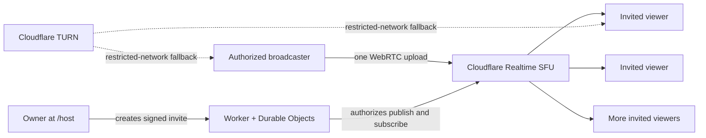

# Jiahao Private Cinema v2

An invitation-only watch-together cinema designed for long-term deployment on Cloudflare.

The owner creates a private screening at `/host`, sends signed invitations, and shares a browser tab or screen. The media is published once to Cloudflare Realtime SFU and distributed to invited viewers. Movie files are not uploaded to the Worker or Durable Objects.

## What changed in v2

- Real server-side owner, host, and viewer permissions
- Cryptographically signed, expiring and revocable invitations
- One-time WebSocket tickets so invitation tokens do not stay in socket URLs
- Cloudflare Realtime SFU: the broadcaster uploads once instead of once per viewer
- No application-level viewer cap
- Simulcast quality layers: Data saver, Balanced, High, and Auto
- TURN credentials only for authenticated people who are already inside a room
- Room locking, removal, guest-host invitations, and invitation revocation
- Cross-country stream diagnostics: route, transport, bitrate, RTT, packet loss, jitter, resolution, and FPS
- Server-side duplicate-connection protection and automatic reconnect
- Chats are transient and are not persisted
- Login and media endpoint rate limits plus strict browser security headers

## Architecture



## Deploy

Read [DEPLOY.md](DEPLOY.md). It covers the six required secrets, the safe upgrade path from v1, and the first real two-network test.

After deployment:

1. Open `https://your-domain.example/host`.
2. Sign in with the owner password.
3. Create a room and copy a viewer invitation.
4. Open the invitation on a different device/network.
5. Start broadcasting and choose a Chrome or Edge tab with **Share tab audio** enabled.

For a local file, MP4/H.264/AAC is the most browser-friendly combination. The file stays on the broadcaster's computer. Streaming services with DRM may intentionally show a black screen; this project does not bypass DRM.

## Development

```text
npm install
npm run check
npm run dev
```

No permanent credential belongs in the repository. Put every secret in Cloudflare **Variables and Secrets** as a Secret.

## Operational notes

- The root page has no public room list. Without a valid invitation it is a closed door.
- Room and invitation lifetime is limited to seven days; create a new room for a later screening.
- Locking a room blocks new devices while preserving reconnect access for viewers already admitted with that invitation.
- A guest-host link grants real broadcasting permission. Treat it as sensitive and revoke it after use.
- “Cloudflare TURN fallback is ready” means TURN credentials are available, not that the current stream is consuming TURN bandwidth.
- The Network panel reports the actual selected WebRTC path and live transport statistics.

See [SECURITY.md](SECURITY.md) for the trust model and [TESTING.md](TESTING.md) for the pre-release checklist.

## v2.2.1 resilient private route and endpoint subtitles

- Up to three viewers use separate direct P2P fast paths. A fourth viewer
  switches the room to SFU fan-out so Host upload does not grow without bound.
- The control WebSocket now sends a heartbeat. Losing that control connection
  briefly no longer stops screen capture or immediately tears down healthy
  media; the server grants the broadcaster a 30-second reconnect window.
- Failed or disconnected P2P routes fall back to the SFU and retry direct ICE
  with bounded backoff. Returning online also triggers a direct-route retry.
- Every endpoint can load one or more local `.srt`/`.vtt` files, select its own
  language track, and adjust its own subtitle offset. Subtitle files remain on
  that device and are never uploaded.

Endpoint subtitles are intentionally separate from the video. For a captured
Tencent/streaming tab the cinema cannot read the third-party player's pause or
seek position, so use the ±1 second offset controls and avoid seeking after
alignment. A later caption service can publish timestamped speech-to-text and
translations over the room control channel without changing the media route.

## v2.1.1 small-room routing and reconnection

- Up to three viewers can now receive separate direct WebRTC connections from
  the Host. Adding a second viewer no longer forces the whole room onto the
  Cloudflare SFU.
- A fourth viewer switches the room to SFU fan-out so Host upload and encoding
  do not continue growing without a bound.
- Each admitted browser now keeps a stable logical participant ID. Replacing a
  Wi-Fi connection with mobile data still requires ICE/WebSocket reconnection,
  but the replacement session is no longer presented as a brand-new device.
- The local-video picker now allows MKV files. Playback still depends on the
  codecs inside the container; when the browser cannot decode a file, remux it
  to browser-compatible MP4 or share a VLC/mpv window.
- P2P is not limited to a LAN. ICE tries direct internet candidates first and
  can use the authenticated TURN service when NAT or firewall rules prevent a
  direct path.

Small-room direct fan-out trades server routing for Host resources. At the
default 2.2 Mbps profile, three viewers may require roughly 6.6 Mbps plus
protocol overhead of sustained Host upload. Use the SFU for larger rooms.

## v2.1.0 hybrid media routing

- With exactly one viewer, the cinema now establishes a direct WebRTC P2P fast
  path while keeping the Cloudflare SFU stream available as a fallback.
- If direct ICE succeeds, the viewer automatically leaves the SFU download and
  the Network panel changes to **Direct P2P**.
- If P2P fails, the existing SFU playback continues without interrupting the
  screening. TURN candidates remain available for restrictive NATs and
  firewalls.
- When a second viewer enters, direct mode closes and every viewer uses the SFU
  so Host upload does not grow once per audience member.
- Selected-candidate detection now also uses WebRTC transport stats, which fixes
  `UNKNOWN` route/transport reporting in WebKit-based iPhone browsers.

This mirrors the practical two-person/group split used by mature watch-party
products: direct media for two devices, relayed media for groups. The website,
authentication, room state and signaling still run on Cloudflare in both modes.

## v2.0.3 mobile playback update

- Best quality and Balanced are adaptive preferences. They can step down when a
  phone or network cannot sustain the preferred simulcast layer.
- Default 720p publishing is capped at 2.2 Mbps; the optional 1080p profile is
  capped at 3.5 Mbps to avoid turning moderate loss into severe frame stalls.
- Data saver remains an explicit low-bandwidth choice.
- Packet loss and frame drops are reported per five-second interval instead of
  as misleading lifetime totals.
- Host diagnostics consistently show the largest active simulcast layer rather
  than whichever RTP report the browser returned last.
- TURN credential generation now sends the request body documented by
  Cloudflare (`ttl` only), fixing the observed HTTP 400 warning.

For mobile viewers, leave Quality on **Auto (recommended)**. Best quality means
"prefer the best available layer," not "ignore congestion and force 1080p."

## License

This is proprietary software. All rights reserved. See [COPYRIGHT.md](https://github.com/jujizh/jujizh-jiahao-private-cinema-cloudflare/blob/main/COPYRIGHT.md). No open-source license is granted.
