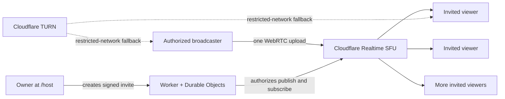

# Jiahao Private Cinema v2

An invitation-only watch-together cinema designed for long-term deployment on Cloudflare.

The owner creates a private screening at `/host`, sends signed invitations, and shares a browser tab or screen. The media is published once to Cloudflare Realtime SFU and distributed to invited viewers. Movie files are not uploaded to the Worker or Durable Objects.

## What changed in v2

- Real server-side owner, host, and viewer permissions
- Cryptographically signed, expiring and revocable invitations
- One-time WebSocket tickets so invitation tokens do not stay in socket URLs
- Cloudflare Realtime SFU: the broadcaster uploads once instead of once per viewer
- No application-level viewer cap
- Simulcast quality layers: Data saver, Balanced, High, and Auto
- TURN credentials only for authenticated people who are already inside a room
- Room locking, removal, guest-host invitations, and invitation revocation
- Cross-country stream diagnostics: route, transport, bitrate, RTT, packet loss, jitter, resolution, and FPS
- Server-side duplicate-connection protection and automatic reconnect
- Chats are transient and are not persisted
- Login and media endpoint rate limits plus strict browser security headers

## Architecture



## Deploy

Read [DEPLOY.md](DEPLOY.md). It covers the six required secrets, the safe upgrade path from v1, and the first real two-network test.

After deployment:

1. Open `https://your-domain.example/host`.
2. Sign in with the owner password.
3. Create a room and copy a viewer invitation.
4. Open the invitation on a different device/network.
5. Start broadcasting and choose a Chrome or Edge tab with **Share tab audio** enabled.

For a local file, MP4/H.264/AAC is the most browser-friendly combination. The file stays on the broadcaster's computer. Streaming services with DRM may intentionally show a black screen; this project does not bypass DRM.

## Development

```text
npm install
npm run check
npm run dev
```

No permanent credential belongs in the repository. Put every secret in Cloudflare **Variables and Secrets** as a Secret.

## Operational notes

- The root page has no public room list. Without a valid invitation it is a closed door.
- Room and invitation lifetime is limited to seven days; create a new room for a later screening.
- Locking a room blocks new devices while preserving reconnect access for viewers already admitted with that invitation.
- A guest-host link grants real broadcasting permission. Treat it as sensitive and revoke it after use.
- “Cloudflare TURN fallback is ready” means TURN credentials are available, not that the current stream is consuming TURN bandwidth.
- The Network panel reports the actual selected WebRTC path and live transport statistics.

See [SECURITY.md](SECURITY.md) for the trust model and [TESTING.md](TESTING.md) for the pre-release checklist.

## License

This is proprietary software. All rights reserved. See [COPYRIGHT.md](COPYRIGHT.md). No open-source license is granted.
